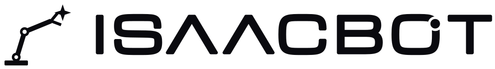

<p align="center">
  <picture>
    <source media="(prefers-color-scheme: dark)" srcset="icons/isaacbot-lockup-white.svg">
    
  </picture>
</p>

# isaacbot_amr_perception

Lightweight, CPU-first perception for the isaacbot. It replaces the earlier Isaac ROS
FoundationStereo / FoundationPose kit (a ~50 GB Docker image, 5-8 GB of VRAM, 0.15-1.7 Hz,
x86 only). That kit is gone from the tree; it stays in the git history (commit `facba89`).

Everything runs natively in the normal colcon workspace: no Docker image of its own, no private
zenoh router, no CUDA requirement. It runs in `ardennes-sensors`, next to the drivers it consumes:
`isaacbot_amr_sensors_bringup` starts the drivers (`isaacbot_amr_sensors`, the RealSense in `isaacbot_amr_realsense`),
then includes `isaacbot_amr_perception.launch.py`. Perception starts no driver itself.

| Package | What it does | Cost |
|---------|--------------|------|
| `isaacbot_amr_perception_bringup` | One launch file starting the parts below behind switches | - |
| `isaacbot_amr_perception_detection` | YOLO nano (ONNX Runtime) -> `detections` (`vision_msgs/Detection2DArray`) | CPU 2 threads, or about 0.3 GB VRAM with CUDA |
| `isaacbot_amr_perception_terrain` | RANSAC ground plane on `rslidar_points` -> `terrain/incline` (forward / lateral / slope in degrees) | one core at 5 Hz |
| `isaacbot_amr_perception_fmoc` | fmoc (follow-me on camera): Intel's ADBSCAN person clustering on `camera/depth/points` plus a tracker -> `tracked_person` (`isaacbot_amr_msgs/TrackedPerson`) | about a quarter of a Pi 5 core at 5 Hz (estimate) |
| *(bringup)* fiducials | `apriltag_ros` on the colour stream | one core at 15 Hz |

Camera: RealSense D435i, driven by `isaacbot_amr_sensors/isaacbot_amr_realsense` (colour, depth and the depth
point cloud). Its frames hang off `<namespace>/camera_link`, which the URDF (`isaacbot_amr_description`)
provides at an **assumed** mount pose until the real one is measured.

## Switches

All are environment variables, so on the isaacbot they are balenaCloud fleet or device variables
(see `rover_docker/README.md`). The same names work as launch arguments (`use_camera:=true`).

| Variable | Default | Effect |
|----------|---------|--------|
| `ISAACBOT_AMR_SYSTEM_USE_CAMERA` | `false` | the camera-fed nodes below may run (the driver itself is `isaacbot_amr_sensors`') |
| `ISAACBOT_AMR_SENSORS_CAMERA_FIDUCIALS` | `false` | AprilTag |
| `ISAACBOT_AMR_SENSORS_CAMERA_DETECTION` | `false` | object detection (needs `ISAACBOT_AMR_SENSORS_CAMERA_DETECTION_MODEL`) |
| `ISAACBOT_AMR_SENSORS_CAMERA_DETECTION_LABELS` | `person` | classes the detector publishes, comma-separated; empty = all 80 COCO classes |
| `ISAACBOT_AMR_SENSORS_PERSON_DETECTION` | `off` | `required`: fmoc picks up only clusters inside a detected person (needs the detection above) |
| `ISAACBOT_AMR_SENSORS_TERRAIN` | `false` | ground slope from the lidar |
| `ISAACBOT_AMR_SYSTEM_FOLLOW_ME_ENABLE` | `false` | fmoc person tracking (`use_person_tracking`); the same variable starts follow-me in `ardennes-orchestrator` |

Person tracking is not gated by `ISAACBOT_AMR_SYSTEM_USE_CAMERA`: it only needs `camera/depth/points`, which
Gazebo publishes without the driver. Driver knobs (`ISAACBOT_AMR_SENSORS_CAMERA_DEPTH_CLOUD`, `ISAACBOT_AMR_SENSORS_CAMERA_FPS`,
`ISAACBOT_AMR_SENSORS_CAMERA_DEPTH_PROFILE`) are `isaacbot_amr_realsense` arguments now.

## Run

`isaacbot_amr_perception_fmoc` uses `isaacbot_amr_msgs` (`isaacbot_amr_ros`), so clone that next to this repo.

```bash
sudo apt install ros-lyrical-apriltag-ros ros-lyrical-vision-msgs ros-lyrical-cv-bridge
pip install onnxruntime        # only for detection; onnxruntime-gpu for CUDA
colcon build --symlink-install --packages-up-to isaacbot_amr_perception_bringup isaacbot_amr_realsense
# the driver (isaacbot_amr_sensors), then perception on top of it
ros2 launch isaacbot_amr_realsense isaacbot_amr_realsense.launch.py
ros2 launch isaacbot_amr_perception_bringup isaacbot_amr_perception.launch.py use_camera:=true use_terrain:=true
```

On the isaacbot both come from one launch: `isaacbot_amr_sensors_bringup/isaacbot_amr_sensors.launch.py`.

A D435i inside WSL2 needs a usbipd attach first: `isaacbot_amr_realsense/scripts/attach_camera.sh` (in
`isaacbot_amr_sensors`; `--once`, `--detach`). It then needs
`sudo chmod a+rw /dev/video* && sudo chmod -R a+rw /dev/bus/usb`; both reset on every re-attach.

Detection model, once, not committed (`models/*.onnx` is git-ignored). 320 px is about 4x
cheaper than 640 and enough for a person at follow-me range:

```bash
yolo export model=yolo11n.pt format=onnx imgsz=320
```

Ultralytics YOLO11 weights are AGPL-3.0. For a isaacbot that is shipped to others, export a
permissively licensed model instead (YOLOX or RT-DETR, Apache-2.0); the detector only needs
the v8/v11 output layout `yolo_onnx.decode()` reads, or another `Detector` implementation.

## Cost on your machine

`isaacbot_amr_perception_bringup/scripts/benchmark.sh [seconds] [launch args]` launches the stack (with
`use_camera:=true` also the `isaacbot_amr_realsense` driver), then prints
per-process CPU (percent of one core) and memory plus the real topic rates. Run the same command on the
dev laptop and on the isaacbot, ideally with the rest of the isaacbot's stacks running.

Dev laptop (i9-13900HX), camera + depth cloud + AprilTag + terrain, 15 fps: about 21 % of one core in
total and 330 MB. With `camera_fps:=6 fiducials_decimate:=4.0`: 7 %. A Raspberry Pi 5 core is roughly
3-4x slower (an estimate, not measured). Knobs: `ISAACBOT_AMR_SENSORS_CAMERA_FPS` (6, 15 or 30), `ISAACBOT_AMR_SENSORS_CAMERA_DEPTH_PROFILE`,
`ISAACBOT_AMR_SENSORS_CAMERA_FIDUCIALS_DECIMATE`, `ISAACBOT_AMR_SENSORS_CAMERA_DETECTION_MAX_RATE`.

## Topics

| Topic | Type | From |
|-------|------|------|
| `camera/color/image_raw`, `camera/depth/image_rect_raw` | `sensor_msgs/Image` | realsense2_camera (`isaacbot_amr_realsense`, input) |
| `camera/depth/points` | `sensor_msgs/PointCloud2` | depth_image_proc (`isaacbot_amr_realsense`, input) |
| `detections` | `vision_msgs/Detection2DArray` | detection_node |
| `tag_detections` | `apriltag_msgs/AprilTagDetectionArray` | apriltag_node |
| `terrain/incline` | `geometry_msgs/Vector3Stamped`: x forward, y lateral, z total slope, degrees, positive = ground rising along +x / +y | terrain_node |
| `terrain/ground_confidence` | `std_msgs/Float32` (inlier ratio) | terrain_node |
| `tf` | AprilTag poses | apriltag_node |
| `tracked_person` | `isaacbot_amr_msgs/TrackedPerson`: state NONE/TRACKING/COASTING/LOST, position and velocity in `<namespace>/odom` | fmoc |
| `tracked_person/markers` | `visualization_msgs/MarkerArray`: clusters, acquire zone, target | fmoc |
| `tracked_person/reset` (service) | `std_srvs/Trigger`: drop the target | fmoc |

Camera and lidar streams are best-effort sensor data, per the workspace QoS rules.

## Person tracking (fmoc)

`fmoc` only perceives: it never drives. `isaacbot_amr_orchestrator`'s `isaacbot_amr_follow_me` turns a tracked
person into a Nav 2 `FollowObject` goal when asked to (`follow_me/start`); any other consumer can
use `tracked_person` too.

- **Acquire.** A person-sized cluster (0.15-1.0 m wide, at least 0.6 m tall) standing 1.5 m in
  front of the isaacbot, within 0.6 m, while the isaacbot stands still. `tracked_person/markers` shows
  the clusters, the acquire zone and the target.
- **Track.** In the global frame (odom), nearest cluster to a constant-velocity prediction, so the
  isaacbot's own motion does not move the target.
- **Lost and found.** A briefly hidden person stays COASTING; a person-sized cluster near the last
  sighting is re-identified for 10 s.
- **Only people** (`ISAACBOT_AMR_SENSORS_PERSON_DETECTION=required`, with `ISAACBOT_AMR_SENSORS_CAMERA_DETECTION=true`).
  ADBSCAN alone takes anything person-sized: a box, a chair, a pole, once the isaacbot's own front.
  With detection required, the cloud's points are projected into the colour image
  (`camera/color/camera_info`, TF `base_link → camera_color_optical_frame`). The points inside a
  YOLO `person` box (`detections`, taken within 0.8 s of the depth frame) are split out of their
  cluster as the person, so a person standing next to a box or a wall (one ADBSCAN cluster with it)
  is a person-sized cluster again. Of the clusters in a box, the nearest is the person, not the
  wall or pole behind them (`domain/person_evidence.py`). Acquiring and re-finding take only
  people; following takes a person in the tracking radius over a nearer non-person. It tolerates
  frames without a box (the detector runs at 2–3 Hz), but after `tracker.person_timeout` (3 s)
  without one the track is lost, so it cannot stay stuck on a pole.
  No detections at all means nobody is picked up: a missing detector never falls back to "anything
  person-sized". The markers colour clusters green (person) or red (not a person).

Parameters: `isaacbot_amr_perception_fmoc/config/fmoc.yaml` (`/**/fmoc:`, the node runs in the isaacbot
namespace).

### ADBSCAN

`isaacbot_amr_perception_fmoc/domain/adbscan.py` ports `adaptive_parameters()` (`doDBSCAN.cpp`), the
KD-tree `dbscan_adaptiveK()` (`dbscan_adaptiveK.cpp`) and the centroid/box helpers (`Util.cpp`)
from Intel's [follow-me component](https://github.com/open-edge-platform/edge-ai-suites/tree/main/robotics-ai-suite/components/adbscan)
(Apache-2.0, see `NOTICE`), keeping its semantics: per-point K and eps from the forward distance,
asymmetric neighbourhoods, border points that expand. Departures, each deliberate:

| Intel | Here | Why |
|-------|------|-----|
| Cloud rotated with a hardcoded optical-frame swap, mount ignored | TF `camera frame → base_link` | The real mount pose, any camera frame. |
| Ground filter off for RealSense (`Z_based_ground_removal: 0.05` truncates to 0) | Height band 0.15–1.9 m above `base_link` | The floor otherwise clusters with the feet. |
| Target kept in the camera frame; nearest centroid to the last one | Global frame, nearest to a constant-velocity prediction; acquisition needs a person-sized cluster and a still isaacbot | The isaacbot's own motion does not move the target; a wall or box is not picked up. |
| eps from the cloud's density only | Optional floor `min_eps + min_eps_per_m · x` (on in `fmoc.yaml`) | Alone in an open space a person at 3–4 m turned into noise: eps shrank below the subsampled point spacing. |
| PCL KD-tree | SciPy `cKDTree` (numpy fallback, same result) | Pure Python, arm64. |
| `cmd_vel` straight to the base | `TrackedPerson` → `isaacbot_amr_follow_me` → Nav 2 Following server → `cmd_vel_nav` | Nav 2's safety chain stays in the loop. |

Cost: with `filter.*_stride: 5` and `max_points: 2500`, a frame with a wall and two people
(about 2k points) takes 14 ms on a dev laptop with SciPy, 33 ms with the numpy fallback. A Pi 5
core is estimated (not measured) at 3–4× slower: about a quarter of a core at
`process_rate: 5.0`. Lower it, or raise the strides, if `fmoc` takes too much.

Limits: without `ISAACBOT_AMR_SENSORS_PERSON_DETECTION=required`, anyone person-sized is a person. With it,
any person will do: it does not tell *which* person (no re-identification), so following someone
past a second person relies on the tracker's position prediction. The camera pose comes from TF,
whose mount is still an ASSUMPTION in the URDF.

## Tests

```bash
cd isaacbot_amr_perception_terrain && PYTHONPATH=. python3 -m pytest test
cd isaacbot_amr_perception_detection && PYTHONPATH=. python3 -m pytest test
cd isaacbot_amr_perception_fmoc && PYTHONPATH=. python3 -m pytest test
```

`isaacbot_amr_perception_fmoc/test/unit/synthetic_scene.py` ray-casts a D435i-like depth cloud of people,
walls and floor; one ADBSCAN test needs SciPy.

The domain and application layers import no ROS, so these run without a sourced workspace.
